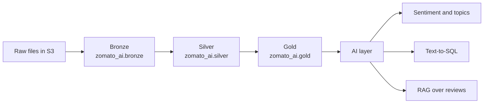

# zomato-data-engineering-ai-project
An end-to-end data engineering project on Databricks. It takes raw food delivery data through bronze, silver, and gold layers, then adds an AI layer on top: review sentiment, natural-language questions over the data (text-to-SQL), and search over customer reviews (RAG).

## Architecture



## Tech stack

- Databricks (Unity Catalog, Delta Lake, Lakeflow Jobs)
- AWS S3 (separate buckets for raw, staging, and published data)
- PySpark and SQL
- Databricks AI Functions, Vector Search, and a hosted chat model

## Data

Synthetic food delivery data with seven datasets: `orders`, `restaurants`, `reviews`, `users`, `food`, `menu`, and `order_items`. The reviews table has 300,000 rows.

## Layers

**Bronze** (`zomato_ai.bronze`): The raw files are read from an external volume on S3 and loaded as Delta tables, one per dataset. Nothing is changed here, so there is always an untouched copy of the source.

**Silver** (`zomato_ai.silver`): The data is cleaned and standardized. Relationship checks confirm that orders match real users and restaurants, and that order items match real orders.

**Gold** (`zomato_ai.gold`): Tables ready for analysis:
- Dimensions: `dim_users`, `dim_restaurants`, `dim_food`
- Facts: `fact_orders`, `fact_reviews`
- Aggregates: `agg_daily_sales`, `agg_restaurant_performance`, `agg_city_order_status`

## AI layer

1. **Review sentiment and topics** (`01_review_sentiment`): The 300,000 reviews contain only 294 distinct comments. Instead of paying to analyze every row, I label each distinct comment once with `ai_analyze_sentiment` and `ai_classify`, then join the results back to all reviews. This produces `comment_enrichment`, `review_enriched`, and `agg_restaurant_sentiment`.
2. **Text-to-SQL** (`02_text_to_sql`): Ask a question in plain English and get an answer from the gold tables. The table schema and allowed values are read from `information_schema`, a hosted chat model writes the query, and a SELECT-only guard blocks anything that would change data. I checked the answers against my own SQL on four test questions.
3. **RAG over reviews** (`03_rag_reviews_v2`): Review comments are embedded and stored in a Databricks Vector Search index (`comment_index`) that syncs from a Delta table. Retrieval is filtered by sentiment so that questions like "what do customers say about packaging complaints" return relevant comments.

## Pipeline

The Lakeflow Job `zomato_pipeline` chains the notebooks in order:

`bronze_ingest` → `silver_stage` → `gold_published` → `ai_review_sentiment` → `rag`

A full run takes about 6 minutes. Text-to-SQL is run separately because it is interactive.

## Repo structure

```
common/       shared setup and helper code
ingest/       bronze layer notebooks
stage/        silver layer notebooks
published/    gold layer notebooks
ai/           sentiment, text-to-SQL, and RAG notebooks
```

## How to run

1. Create the S3 buckets and Databricks external locations for the raw, staging, and published layers.
2. Create the `zomato_ai` catalog and the `bronze`, `silver`, and `gold` schemas.
3. Upload the source files to the raw volume.
4. Run the `zomato_pipeline` job, or run the notebooks in order: ingest, stage, published, ai.

## Credits

Built while following the "Zomato AI Data Analytics" tutorial on YouTube, with changes: I used Databricks instead of Snowflake/dbt/Airflow and generated synthetic data.
